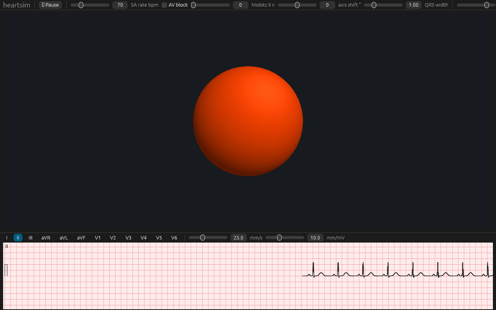

# heartsim

**A 3-D heart electrophysiology and 12-lead ECG simulator for medical education, in Rust.**
Windows · macOS · Linux (WebAssembly planned). Educational use only — not a medical device.

heartsim shows electrical activation spreading over a three-dimensional heart while the 12-lead ECG that activation produces draws
in real time. Learners change the physiology — rates, blocks, pathways, ectopic foci, ischaemia, electrodes, pacing, drugs — and
see the consequences in both views at once. It is inspired by Epicardio Simulation, cardiacrhythmsim.com, ECGSIM and the
open-source ECG axis trainer, and is built as a clean-room, open-source implementation (MIT OR Apache-2.0).



More screenshots: [sinus beat on the heart](docs/images/simulator-sinus.png),
[LBBB with the heart-vector arrow, scrubbed](docs/images/simulator-lbbb-vector.png),
[vectorcardiogram](docs/images/heart-vector-lbbb.png), [WPW](docs/images/simulator-wpw.png),
[Wenckebach 12-lead](docs/images/twelve-lead-mobitz1.png), [rhythm quiz](docs/images/rhythm-quiz.png). They are regenerated
headless with `HEARTSIM_SCREENSHOT_DIR=docs/images VK_ICD_FILENAMES=/usr/share/vulkan/icd.d/lvp_icd.x86_64.json
WGPU_BACKEND=vulkan WINIT_UNIX_BACKEND=x11 xvfb-run -a -s "-screen 0 1280x800x24" cargo run -p heartsim-app`.

## Status
M0 foundation (2026-10-31): workspace, core types, timing engine (SA/AV/His/escape, AV recovery curve, Mobitz II), Tier-0 12-lead
synthesiser, ECG ring buffers with min/max decimation, offscreen wgpu viewport, eframe app with a live strip, CLI export.
See [docs/ROADMAP.md](docs/ROADMAP.md) for what comes next and [docs/briefs/](docs/briefs/) for the work packages.

## Build and run
```bash
cargo run --release -p heartsim-app
```
```bash
cargo run -p heartsim-cli -- synth --bpm 70 --seconds 10 --out ecg.csv
```
```bash
cargo run -p heartsim-cli -- run assets/scenarios/lbbb.ron --seconds 12 --out exports/
```
```bash
cargo xtask ci
```
The `run` command writes the 12-lead PDF, PNGs, CSV, WFDB record, scenario file and share bundle that the app's Export window
writes. The user and developer guide is in [`docs/book`](docs/book/src/SUMMARY.md) (`mdbook serve docs/book`) and is published
to GitHub Pages.
Linux needs `libxkbcommon-dev libwayland-dev libasound2-dev` (Debian/Ubuntu names). Toolchain is pinned in `rust-toolchain.toml`.

## Layout
`crates/heartsim-{core,geometry,sim,ecg,render,ui,io,app,cli}` (see [docs/ARCHITECTURE.md](docs/ARCHITECTURE.md)); `assets/` scenarios
and locales; `docs/` requirements, architecture, roadmap, and research notes; `xtask/` automation.

## Contributing
Read [CLAUDE.md](CLAUDE.md) (also the human contributor guide): layering rules, determinism, licensing, and the definition of done.
Pathologies are data (`assets/scenarios/*.ron`); adding one needs no code.

## Licence
Code: MIT OR Apache-2.0. Assets: see `ASSETS-LICENSES.md` (only CC BY / CC0 / OFL material is shipped).
