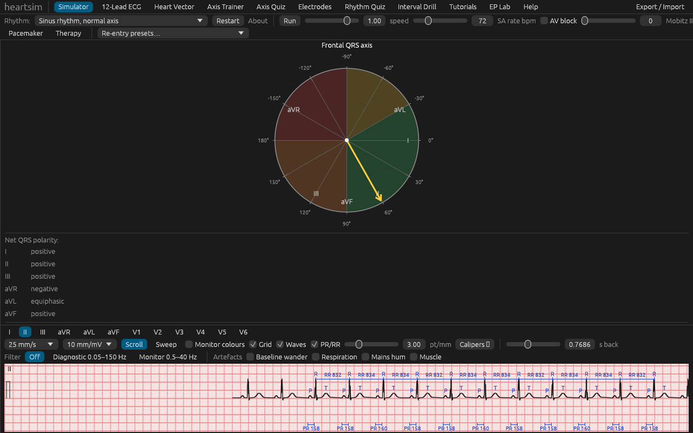

# heartsim

**A 3-D heart electrophysiology and 12-lead ECG simulator for medical education, in Rust.**
Windows · macOS · Linux · web browser. Educational use only — [not a medical device](docs/book/src/user/disclaimer.md).

heartsim shows electrical activation spreading over a three-dimensional heart while the 12-lead ECG that activation produces
draws in real time. Learners change the physiology — rates, blocks, accessory pathways, ectopic foci, ischaemia, electrode
placement, pacing, drugs, ablation — and see the consequences in both views at once. The strip and the colours on the heart
come from the same simulation step, so they can never disagree: pause, scrub back, and the heart shows that instant.

It is a clean-room, open-source implementation (MIT OR Apache-2.0) written from the published literature, inspired by
Epicardio Simulation, cardiacrhythmsim.com, ECGSIM and the open-source ECG axis trainer. It contains no code, data or assets
from any other simulator.



## Get it

| | |
|---|---|
| **Desktop installers** | [Latest release](https://github.com/inalto/heartsim/releases/latest): `.deb` and AppImage for Linux, `.msi` and setup `.exe` for Windows, universal `.dmg` for macOS, with `SHA256SUMS`. The installers are unsigned, so Windows SmartScreen and macOS Gatekeeper warn before the first run. |
| **In the browser** | <https://inalto.github.io/heartsim/app/> — nothing to install. No export or file features, and slower than the desktop build. |
| **User and developer guide** | <https://inalto.github.io/heartsim/> — installing, a tour of the window, the rhythm library, tutorials and quizzes, exports, the EP lab, FAQ; architecture, adding a scenario or a drug, tests and benchmarks, file formats. |
| **Known limitations and open questions** | [docs/book/src/known-issues.md](docs/book/src/known-issues.md) — what nobody has run on real hardware yet, and the numbers and clinical statements that still need a clinician's check. Read it before teaching with heartsim. |
| **Wiki** | <https://github.com/inalto/heartsim/wiki> — overview pages, release notes and how to contribute. |

## What it does

* **Simulator.** A 3-D heart (chambers, great vessels, valve rings, torso) coloured by membrane voltage, activation time or
  action-potential duration; the heart-vector arrow and its loop; the frontal-axis circle; one lead at a time on paper or on a
  monitor sweep, with calipers, wave letters and interval brackets; pause and scrub up to 60 s back. Click to stimulate,
  shift-click to ablate.
* **Three simulation tiers**, deterministic for a given scenario and seed: a timing engine with a 12-lead synthesiser (Tier 0),
  an eikonal activation model on the heart with a forward ECG (Tier 1), and a reaction–diffusion engine for re-entry (Tier 2).
* **69 rhythm scenarios** as data files (`assets/scenarios/*.ron`): sinus variants, every grade of AV block, bundle-branch and
  fascicular blocks, ectopic beats and runs, atrial and junctional tachycardias, WPW and AVRT, flutter, AF and pre-excited AF,
  VT, torsades, VF, pacemaker rhythms and faults, ischaemia and infarction in every territory at every stage, pericarditis.
  Each one carries an explanation, the rhythms it is confused with and references.
* **Physiology controls.** Sinus rate, AV block, Mobitz II ratio, axis shift, QRS width, speed; a pacemaker window (AAI, VVI,
  DDD, biventricular, capture and sensing faults); an ischaemia panel by coronary territory; a drug table; a defibrillator.
* **Re-entry.** A persistent-AF preset on the detailed engine: shock it, ablate round the pulmonary veins, give drugs, and hand
  the heart back to the fast engine when it is in sinus rhythm.
* **The EP lab.** Five catheters (HRA, His, CS decapolar, RVA, ablation) placed in the chambers, unipolar and bipolar
  electrograms at 100–200 mm/s with AH and HV calipers, programmed stimulation (S1×n/S2/S3, decremental, ERP search,
  entrainment with PPI − TCL) and RF ablation, in five procedures: baseline study, AVNRT, left-lateral accessory pathway,
  typical flutter with a CTI line, AF with pulmonary-vein isolation.
* **12-lead page** in 12 × 1, 6 × 2 and clinical 3 × 4 layouts with a rhythm strip, Cabrera order, display filters
  (diagnostic 0.05–150 Hz, monitor 0.5–40 Hz) and artefacts (baseline wander, respiration, mains hum, muscle) that never touch
  the measurements.
* **Teaching tools.** Axis trainer and axis quiz, rhythm quiz with explanations, interval drill graded with calipers,
  electrode-misplacement exercises with a detector, ten tutorials (89 pages) and three scripted patient cases with multiple-choice
  questions, a monitor beep.
* **Exports.** 12-lead PDF, PNGs, CSV, WFDB record, the scenario file and a share bundle; a command line (`heartsim-cli`) that
  writes the same files headless, validates the content, runs the tutorials, and exports a case to openCARP for comparison with
  a scientific solver.
* **Languages and accessibility.** English and Italian interface, high-contrast theme, reduced motion, colour-blind-safe palette.

More screenshots: [LBBB with the heart-vector arrow, scrubbed](docs/images/simulator-lbbb-vector.png),
[vectorcardiogram](docs/images/heart-vector-lbbb.png), [WPW](docs/images/simulator-wpw.png),
[flutter 2:1](docs/images/simulator-flutter.png), [coarse VF](docs/images/simulator-vf.png),
[Wenckebach 12-lead](docs/images/twelve-lead-mobitz1.png), [clinical 3 × 4 layout](docs/images/twelve-lead-clinical.png),
[anterior STEMI](docs/images/twelve-lead-stemi.png), [torsades](docs/images/twelve-lead-torsades.png),
[axis trainer](docs/images/axis-trainer.png), [axis quiz](docs/images/axis-quiz.png), [electrodes](docs/images/electrodes.png),
[rhythm quiz](docs/images/rhythm-quiz.png), [interval drill](docs/images/interval-drill.png),
[tutorials](docs/images/tutorials.png), [the EP lab](docs/images/ep-lab-avrt.png).

## Status

Version 0.8.0 (2026-11-08). The work packages B01–B23 in [docs/briefs/](docs/briefs/) are implemented; [CHANGELOG.md](CHANGELOG.md)
lists what each release added and [docs/ROADMAP.md](docs/ROADMAP.md) the milestones. The program has so far been tested
headless (software rendering, no display) and on GitHub's runners: nobody has yet used it on a real screen, and several
physiology numbers are cited from memory. See [known limitations and open questions](docs/book/src/known-issues.md).

## Build and run

```bash
cargo run --release -p heartsim-app
```
```bash
cargo run -p heartsim-cli -- run assets/scenarios/lbbb.ron --seconds 12 --out exports/
```
```bash
cargo xtask ci
```

The toolchain is pinned in `rust-toolchain.toml`. Linux needs `libxkbcommon-dev libwayland-dev libasound2-dev` (Debian/Ubuntu
names). A first build of the GUI crates takes several minutes; `cargo xtask ci` runs fmt, clippy, the tests, `cargo deny` and
the spell-check. The browser build is `trunk build --release` in `crates/heartsim-web` (see [docs/web.md](docs/web.md)); the
guide is `mdbook serve docs/book`.

The screenshots in `docs/images/` are regenerated headless with
`HEARTSIM_SCREENSHOT_DIR=docs/images VK_ICD_FILENAMES=/usr/share/vulkan/icd.d/lvp_icd.x86_64.json WGPU_BACKEND=vulkan WINIT_UNIX_BACKEND=x11 xvfb-run -a -s "-screen 0 1280x800x24" cargo run -p heartsim-app`.

## Layout

`crates/heartsim-{core,geometry,sim,ecg,render,ui,io,app,cli,web}` in dependency order (see
[docs/ARCHITECTURE.md](docs/ARCHITECTURE.md)); `assets/` scenarios, tutorials, cases, locales and the anatomy pack; `docs/`
requirements, architecture, roadmap, the guide and research notes; `xtask/` automation; `packaging/` installer resources.

## Contributing

Read [CLAUDE.md](CLAUDE.md) (also the human contributor guide): layering rules, determinism, licensing, and the definition of
done. Pathologies are data (`assets/scenarios/*.ron`); adding one needs no code, see
[the guide](https://inalto.github.io/heartsim/dev/adding-a-scenario.html). The most useful contribution right now is a check of
the items on the [known-issues page](docs/book/src/known-issues.md) by someone with a GPU, a browser, or a cardiology textbook.

## Licence

Code: MIT OR Apache-2.0. Assets: see [ASSETS-LICENSES.md](ASSETS-LICENSES.md) (only CC BY / CC0 / OFL material is shipped).
